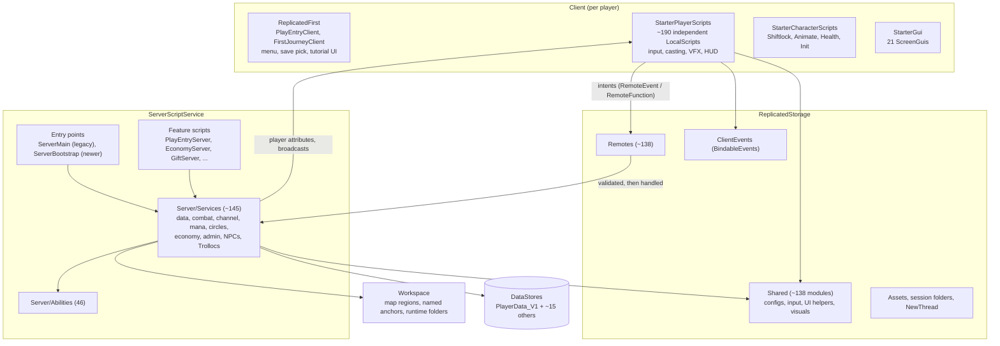
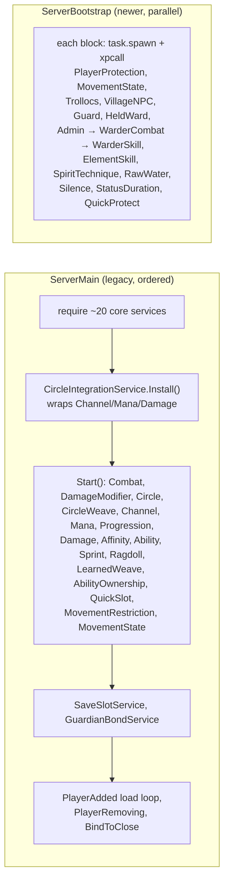
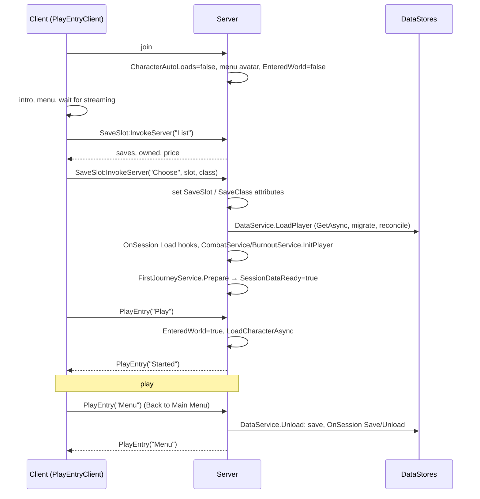
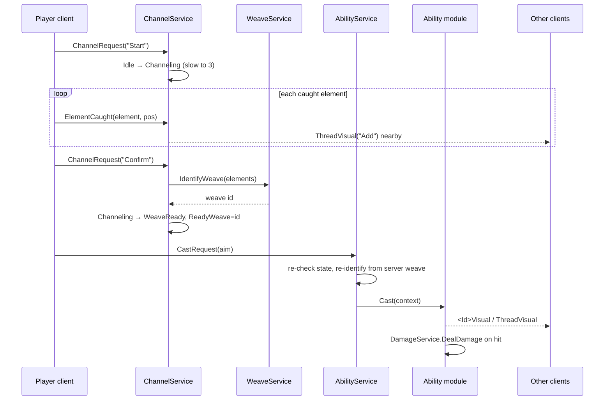

# Architecture

How the pieces of Woven fit together. This doc is the map; each area doc has the detail and the citations. Written from the live place on 2026-11-08.

## 1. Layers

| Layer | Lives in | Role | Doc |
|---|---|---|---|
| Entry flow | `ReplicatedFirst`, `ServerScriptService/PlayEntryServer`, `Services/SaveSlotService`, `Services/FirstJourneyService` | Loading screen, menu, save pick, tutorial gate, spawn | [shared.md §4](shared.md) |
| Server core | `ServerScriptService` | Authority for all gameplay state, persistence, economy, NPCs | [server.md](server.md) |
| Ability system | `Server/Abilities`, channel/ability/circle services | Channeling, weaves, casts, circles, wards | [abilities.md](abilities.md) |
| Shared | `ReplicatedStorage` | Remotes, client bus, configs, helpers, assets | [shared.md](shared.md) |
| Client | `StarterPlayer`, `StarterGui` | Input, presentation, HUD; no authority | [client.md](client.md) |
| World | `Workspace`, `Lighting`, `ServerStorage` | Map, anchors code looks up, NPC assets | [world.md](world.md) |

## 2. Boot

### Server

Two enabled Scripts start the server, with **no defined order between them** ([server.md §3](server.md)):

Other services are started from feature scripts (`TitlesServer`, `MarksShopServer` → FactionWar and ChannelerNPC), from other services (`ManaService` → StatModifier, `AbilityService` → every ability module's `Start`), or by being required (ElementSkill, SpiritTechnique, ShieldingContest, FirstJourney, ChannelRecovery, WaterInteraction connect their remotes in the module body).

**Rule for new work:** new services start from `ServerBootstrap`, with a guarded `Start()`. Only services that must start after `CircleIntegrationService.Install()` belong in `ServerMain`.

### Client

There is **no loader** ([client.md §3](client.md)). Every LocalScript starts on its own in no guaranteed order and syncs through `WaitForChild`, `ChildAdded` watchers and retry loops. `Players.CharacterAutoLoads = false`, so nothing character-related runs until the entry flow spawns the player. StarterPlayerScripts survive respawns; StarterCharacterScripts are re-cloned per character; almost every ScreenGui has `ResetOnSpawn = false`.

## 3. Player lifecycle

On leave, `PlayerRemoving` runs the same `DataService.Unload(player, true)`. On shutdown, `BindToClose` handlers save in ServerMain (sequential), PlayerSettings and MapDiscovery (parallel, 20 s cap) and EconomyServer (25 s deadline). Details: [shared.md §4](shared.md), [server.md §3.2](server.md).

## 4. State model

State lives in five places:

| Where | What | Writers | Readers |
|---|---|---|---|
| **Player attributes** | `CombatState`, `ReadyWeave`, `<Id>Active`/`<Id>Ready`, `Mana`, `Stamina`, `XP`, `<Element>Tier`, `SaveSlot`, `SessionDataReady`, `EnteredWorld`, `Setting_*`, suppression flags (`Stilled`, `MagicSuppressed`, …) | Server only | Server and every client (replicated) |
| **Client UI flags** (player attributes) | `PlayScreenActive`, `BookOpen`, `SettingsOpen`, `EconomyOpen`, `MapOpen`, `MarksShopOpen`, `MobileLayoutEditing`, … | The local client | Local client scripts (TopHUD, Shiftlock, InputController) |
| **Character attributes** | `IFrames`, `Dodging`, `Blocking`, `Stunned`, `IsRagdolled`, `MoveState`, … | Server | Server and clients |
| **Server tables** | Active weaves, ability sessions, cast locks, damage history, economy cache and queues, open save slots | Owning service | Server only |
| **Instances** | Workspace runtime folders (`ActiveAbilityEffects`, `ActiveThreads`, `RawEarthEffects`, `SoloWeaveEffects`, `NPC`), ReplicatedStorage session folders (`FireHoldSessions`, `RawFireSessions`, `FollowingLights`) | Server (client for `ActiveThreads`) | Clients decorate them |

**CombatState** is the core gate: `Idle → Channeling → WeaveReady → (Casting) → Idle`, with `PvP`, `BurnedOut` and `Dead` alongside. Only `CombatService.SetState` writes it.

**Single writers** the code relies on:

| State | Only writer |
|---|---|
| `CombatState` | `CombatService.SetState` |
| WalkSpeed, Jump, AutoRotate | `MovementStateService` (one known exception: `CombatService:256`) |
| Player HP loss | `DamageService.DealDamage` → `FinisherService.TakeDamage` |
| `MarketplaceService.ProcessReceipt` | `Server/GiftServer` |
| Main profile | `DataService` |

## 5. Networking model

- **Clients send intents; the server decides.** Every gameplay remote re-checks state on the server. Server-issued permits or offers (SpiritTechnique, VillageTeachers, Waygates) are the strongest pattern: the client can only redeem a short-lived token.
- **Remote naming:** `<Feature>Action` (C→S input), `<Feature>Visual` (S→C broadcast), `<Feature>Feedback` (caster only), `<Feature>Request` (RemoteFunction or command remote); the first argument is a command string. Full catalogue: [shared.md §2](shared.md).
- **Two kinds of remote instance:** 92 authored in `ReplicatedStorage/Remotes`, ~46 created at runtime by the owning server module with find-or-create. Clients `WaitForChild` both with no timeout.
- **RemoteFunctions** are used only for request/response menus: `AdminRequest`, `GiftRequest`, `EconomyRequest`, `MarksShopRequest`, `PlayerSettings`, `WarderSkillPurchase`, `SaveSlot`, plus runtime `TitlesRequest`, `ElementSkillPurchase`, `ChooseElementAlignment`, `ChangeElementAlignment`.
- **Proximity broadcast:** `Shared/VfxBroadcast.FireNearby` sends transient VFX only to players within 180 / 250 / 350 studs; it falls back to all clients when the position is not a Vector3. `CombatTargets.FireClient` sends caster-only events and skips NPC targets.
- **Push on change plus Ready resync:** for Economy, Titles and Missions the server pushes full state, and the client fires `<Feature>Ready` once its listener is live to get a resend.
- **Client-local bus:** `ReplicatedStorage/ClientEvents` BindableEvents (`ActionBegan`, `ActionEnded`, `ChannelFeedback`, `ThreadHandChosen`, `ControllerElement`, `ControllerQuickSlot`, `ThreadVisualLocal`) are the only way client scripts talk to each other.

## 6. Persistence model

- **Main profile:** `PlayerData_V1`, key `Player_<uid>` (slot 1) or `Player_<uid>_S<n>`. Defaults in `DataService.DEFAULT_DATA`, recursive reconcile on load, one-time migration flags, no schema version. Written by a blind `UpdateAsync` on Unload and shutdown only.
- **Per-save side stores** (settings, economy, bonds) build their key with `SaveSession.Key` and load/save through `DataService.OnSession` hooks. Map discovery is account-wide.
- **Account-wide stores:** `WovenAccount_v1` (save slots, Stilled time), moderation, gifts, factions, titles.
- **Wrapper:** `Services/EconomyStore` (UpdateAsync with retries, ordered stores, in-memory in Studio).
- **Idempotency:** receipts and purchase ids make economy, gift and slot grants safe to retry.
- **Studio:** `PlayerData_V1` is never written and EconomyStore is in-memory; PlayerSettings and MapDiscovery write real stores.

Full store table: [server.md §5.1](server.md).

## 7. Gameplay core: the cast pipeline

Circles wrap this pipeline at boot (`CircleIntegrationService.Install()` replaces Channel/Mana/Damage functions and adds a second `CastRequest` listener). Quick slots skip channeling: `QuickSlotService` prepares the recipe from `WeaveInfoConfig` and calls `CastCurrentWeave` directly. Full trace: [abilities.md §4](abilities.md).

## 8. VFX model

- The server owns gameplay parts (projectiles, rocks, shields) in Workspace folders; they replicate by themselves.
- Every client draws every caster's threads and weave shapes locally, in three patterns ([client.md §6](client.md)):
  1. **Event broadcast** (`ThreadVisual`, `WardVisual`) into `ThreadVisualController` / `WardVisualController`.
  2. **Attribute polling** over `Shared/CasterActors` by "shape" controllers, with distance gates (≈150–250 studs).
  3. **Remote → module bridges**: `<Ability>VisualController` forwards to `Controllers/AbilityVisuals/<Ability>Visual`.
- Concealment (Folded Light, the Ways, dreamwalking) runs through `Shared/WeaveVisibility` and `LocalVisibilityMask`.
- VFX templates live in `ReplicatedStorage/Assets/AbilityEffects`. Copies at the Workspace root are stray ([world.md §3](world.md)).

## 9. Cross-cutting mechanisms

- **Circle wrapping.** `CircleIntegrationService.Install()` monkey-patches ChannelService, ManaService and DamageService. Call those functions as `Module.Fn(...)`; never cache them in locals at require time.
- **Lazy requires.** Services `require` each other inside functions to avoid cycles.
- **Compulsion mirroring.** Multi-stage weaves export `CompulsionAction` so a compelled player's actions can be replayed.
- **WarderGate.** Any player attribute ending in `Active` counts as a live weave and blocks Guardian melee.
- **Studio gates.** `RunService:IsStudio()` branches change persistence, skip the menu, and enable dev tools ([workflow.md §1](workflow.md)).

## 10. Architectural debt

Ranked by impact. Each links to its detail.

| # | Debt | Impact | Detail |
|---|---|---|---|
| 1 | Main profile has no autosave and no session lock | Lost progress on crash; cross-server overwrites | [server.md §10](server.md) |
| 2 | Webhook token stored in `AdminConfig` | Secret exposure to anyone with place access | [server.md §10](server.md) |
| 3 | `CastRequest` `aimPosition` not validated centrally | Each ability must validate; several may not | [abilities.md §11](abilities.md) |
| 4 | Two server entry points with no defined order; unguarded `Start()`s | Ordering bugs, double connections | [server.md §3](server.md) |
| 5 | Two routers in `AbilityService`; mana owned three ways; WeaveConfig text ≠ live data | Easy to mis-tune or double-charge | [abilities.md §9, §11](abilities.md) |
| 6 | Client: 191 per-frame hooks, no loader, many writers per HUD | Scaling cost, UI fights, startup races | [client.md §10](client.md) |
| 7 | Dead and half-dead remotes; disabled scripts still present | Wasted bandwidth, misleading code | [shared.md §6](shared.md), [client.md §8](client.md) |
| 8 | Server-only modules in ReplicatedStorage; 27.5k replicated Warder clip instances | Exposure and join time | [shared.md §8](shared.md) |
| 9 | ~7 MB of backups and stray VFX copies in the place | Slow saves; editing the wrong copy | [world.md §6, §8](world.md) |
| 10 | No source control | No diffs, no review, rollback only via Version History | [workflow.md §10](workflow.md) |

## 11. Direction (recommendations, not decisions)

These are proposals for the owner to accept or reject. None is scheduled.

1. Add a periodic autosave and a session lock to `DataService` (e.g. `UpdateAsync` that compares a session id, or a MemoryStore lease).
2. Rotate the Discord webhook and read it with `HttpService:GetSecret`.
3. Add one shared aim-validation helper (type, NaN, range) and call it from `createAbilityContext`.
4. Fold `ServerMain` into `ServerBootstrap` with an explicit "Install first" phase; guard every `Start()`.
5. Move legacy-routed abilities to the generic `AbilityServicePolicy` path one by one.
6. Remove dead remotes and disabled scripts together with their senders and listeners.
7. Introduce a single HUD mode attribute (Channeler / Guardian / Dialogue / Menu) to replace force-hide writers.
8. Export and prune backups; quarantine stray Workspace copies.
9. Consider Rojo plus git, or at least a periodic script export to git ([workflow.md §10](workflow.md)).
